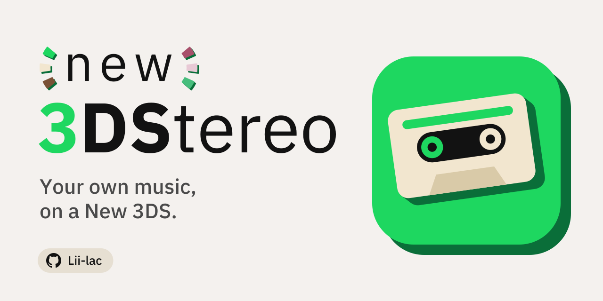
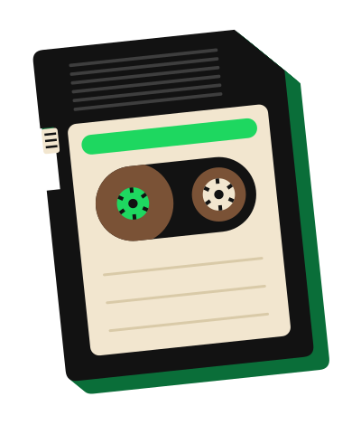
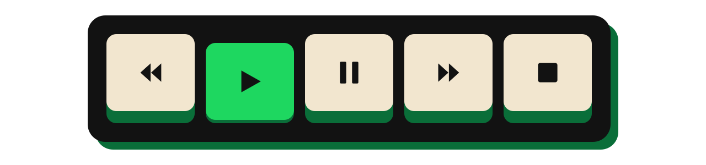
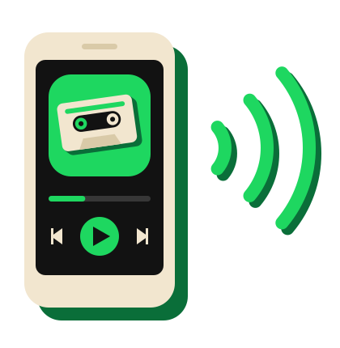
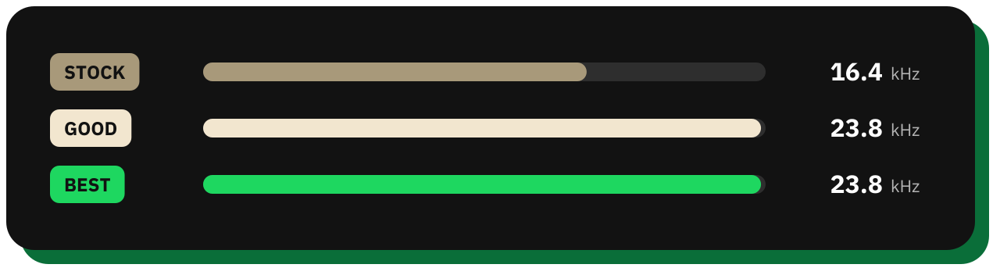
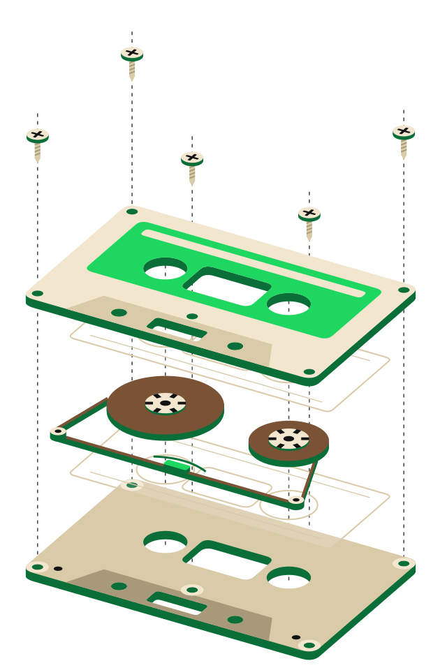

<h1 align="center">
  <picture>
    <source media="(prefers-color-scheme: dark)" srcset="docs/readme/dark/hero.svg">
    
  </picture>
</h1>

<p align="center"><b>Your own music on a New 3DS, with the top end the console usually cuts off. Spotify is the remote.</b></p>

3DStereo plays the FLAC, MP3, WAV, Ogg and Opus files on your SD card at 47.6 kHz instead of the usual 32.7, so cymbals sound
like cymbals. It also appears in Spotify's device list: pick it on your phone and it plays your card.

<p align="center">
  <a href="#install"></a>
  <a href="#using-it"></a>
  <a href="#spotify"></a>
  <a href="#the-sound"></a>
  <a href="#building-it"></a>
</p>

<picture>
  <source media="(prefers-color-scheme: dark)" srcset="docs/readme/dark/div-1.svg">
  
</picture>

### Install

<picture>
  <source media="(prefers-color-scheme: dark)" srcset="docs/readme/dark/art-install.svg">
  
</picture>

You need a **New 3DS, New 3DS XL or New 2DS XL** running **[Luma3DS](https://github.com/LumaTeam/Luma3DS)**.

1. **Dump the DSP firmware** (once): Rosalina menu (L + D-pad down + SELECT) → *Miscellaneous options* → *Dump DSP firmware*.
2. **Install the app** from the [latest release](https://github.com/lii-lac/3DStereo/releases/latest): `3DStereo.cia` with FBI, or
   `3DStereo.3dsx` in `sdmc:/3ds/`.
3. **Add music** to `sdmc:/music/`. Covers come from the tags or a `cover.jpg` / `folder.jpg` beside the songs; playlists are
   `.m3u8` files in `sdmc:/music/playlists/`.

The first launch reads every tag, then only new songs. To read everything again, hold **R** while it opens, or tap
**Settings → Rescan library** and it happens at the next launch.

24-bit files play, but the 3DS only outputs 16 bits. `uv run tools/to16.py ~/Music/Album -o S:/music/Album` copies a folder
dithered to 16-bit.

<br clear="all">

### Using it

<picture>
  <source media="(prefers-color-scheme: dark)" srcset="docs/readme/dark/art-using.svg">
  
</picture>

One screen plays, the other browses. Drag down from the touchscreen's top edge (or up from its bottom) to swap them.

| Button | Does |
|---|---|
| <kbd>A</kbd> | Play or open what's under the cursor |
| <kbd>B</kbd> | Back |
| <kbd>D-pad</kbd> | Move; left and right jump five rows |
| <kbd>ZL</kbd> / <kbd>ZR</kbd> | Switch tabs. <kbd>ZL</kbd> past Home, or on Charts, Settings and Pair, opens the side menu; <kbd>ZR</kbd> puts it away |
| <kbd>L</kbd> / <kbd>R</kbd> | Previous / next song |
| <kbd>X</kbd> | Like. Hold for the song's playlists |
| <kbd>Y</kbd> | Search |
| <kbd>Circle&nbsp;Pad&nbsp;↓</kbd> | Add to the queue. Hold ↑ three seconds to clear it |
| <kbd>SELECT&nbsp;+&nbsp;↑</kbd> | The queue |
| <kbd>SELECT&nbsp;+&nbsp;←</kbd> | Side menu: Library, Charts, Pair, Settings |
| <kbd>SELECT&nbsp;+&nbsp;X</kbd> | Lyrics |
| <kbd>SELECT&nbsp;+&nbsp;Y</kbd> | Sort |
| <kbd>SELECT&nbsp;+&nbsp;R</kbd> | ReplayGain: off, track, album, auto |
| <kbd>SELECT&nbsp;+&nbsp;L</kbd> | Sync with Spotify |
| <kbd>SELECT&nbsp;+&nbsp;START</kbd> | Quit |

Everything is also a tap.

- **Queue:** swipe a row left to remove it (right within ten seconds to undo); drag its handle to reorder.
- **Side menu:** the three bars in the corner (Library, Charts, Pair, Settings), on Charts, Settings and Pair too. Tap an item, or
  D-pad and <kbd>A</kbd>; <kbd>B</kbd> puts it away.
- **Charts:** your most played songs, artists and albums.
- **Lid:** shutting it pauses on the speakers. With headphones in, it keeps playing and ignores the buttons.
- **Resume:** it reopens where you stopped, paused.
- **Resting:** a second and a half without a touch or a button, it redraws 30 times a second instead of 60. Touch it and it's back at 60.
- **Artist pages:** tap an artist for their photo, popular songs and discography. Cached for a week.
- **Lyrics:** from [LRCLIB](https://lrclib.net), synced where available.
- **Extra details:** a switch in Settings that shows the playing file's format (and a LOSSLESS badge) under the song.
- **Playlists:** retype a title, or drag a held song onto one.
- **Gapless**, and ReplayGain on *auto* uses album gain while an album plays in order.

<picture>
  <source media="(prefers-color-scheme: dark)" srcset="docs/readme/dark/div-2.svg">
  
</picture>

### Spotify

3DStereo never streams from Spotify. Every song is a file on your card; Spotify supplies your playlists and the remote.

<picture>
  <source media="(prefers-color-scheme: dark)" srcset="docs/readme/dark/art-spotify.svg">
  
</picture>

**Device list** (Premium): side menu → **Pair**, then type the code it shows at spotify.com/pair. Now 3DStereo appears in
Spotify's device picker while it's open, and Spotify controls it, lid shut or not. It shows up as your profile name and model
("Alex's n2DS XL"); change that in **Settings → Name on Spotify**. If Pair says your clock is wrong, fix the date in System
Settings.

**Playlists:** make an app at [developer.spotify.com](https://developer.spotify.com/dashboard) (redirect URI
`http://127.0.0.1:8765/callback`), put its Client ID in `player/spotify-client-id.txt`, and run `python tools/spotify_pair.py` once.
The 3DS then syncs at launch, every five minutes and on **SELECT + L**: each playlist becomes an `.m3u8` of the songs you have,
and Liked Songs and edits go both ways.

The device list speaks Spotify's protocol like [librespot](https://github.com/librespot-org/librespot), so it's unofficial and may
break.

<br clear="all">

### The sound

<picture>
  <source media="(prefers-color-scheme: dark)" srcset="docs/readme/dark/sound.svg">
  
</picture>

Each bar is the highest pitch (in kHz) that setting keeps. People hear up to about 20.

The 3DS normally outputs 32,728 Hz, which loses everything above 16.4 kHz. Its hardware also has a 47,605 Hz mode nobody uses.
3DStereo switches to it while music plays and restores the console for HOME, sleep and other apps.

Pick how files are resampled in **Settings**:

- **Stock:** the system's resampler, into 32,728 Hz.
- **Good:** the same resampler, into 47,605 Hz.
- **Best:** our own 64-tap sinc resampler with dither to 16 bits. About an eighth of a core on a New 2DS XL.

Output is always 16-bit: a 24-bit / 96 kHz FLAC sounds great, but "lossless" here means the file, not the speaker.

### Building it

<picture>
  <source media="(prefers-color-scheme: dark)" srcset="docs/readme/dark/art-building.svg">
  
</picture>

C on [devkitPro](https://devkitpro.org/) (libctru, citro2d), with curl, mbedTLS, jansson, zlib, [dr_libs](https://github.com/mackron/dr_libs),
stb and opusfile. From `player/`:

```sh
docker run --rm -v "$PWD:/src" -w /src \
  devkitpro/devkitarm make player.3dsx
```

(Git Bash on Windows: prefix `MSYS_NO_PATHCONV=1` and use `$(pwd -W)`.) Plain `make` also builds `player.cia`, which needs
[makerom](https://github.com/3DSGuy/Project_CTR) and [bannertool](https://github.com/Steveice10/bannertool) (or `MAKEROM=` and
`BANNERTOOL=`). `BUILD=` sets the build number.

Settings live in `sdmc:/3ds/player.cfg`; the cache, stats and Spotify logins in `sdmc:/3ds/player/`.
**Settings → Clear cache** lists what the cache holds (covers, artist photos, lyrics, playlist pictures, Spotify matches, the library index) with each size; tick what to clear. Stats, pins and logins are never touched. 3DStereo restarts when it's done.
Covers are kept in 16 subfolders (`covers/3/…`) so a big library doesn't slow the card down, and Clear cache removes covers, artist photos and lyrics a folder at a time, which is quick. Loose cover files left by older builds go the first time you clear *Album covers*.

| Where | What |
|---|---|
| `player/source/main.c` | Screens, input, queue |
| `audio.c`, `decoder.c` | Sound clock, resampler, formats |
| `library.c`, `tags.c` | The card, tag cache, playlists |
| `connect.c`, `cpb.c` | Spotify's device list |
| `spotify.c`, `spotmatch.c` | Playlist sync |
| `meta.c`, `net.c`, `art.c`, `stats.c` | Artist pages, lyrics, covers, plays |
| `tools/` | Spotify logins, PC sync, `to16.py` |
| `docs/readme/` | These pictures; `DESIGN.md` has the rules |

<br clear="all">

---

<sub>3DStereo is a fan-made homebrew app. It isn't affiliated with or endorsed by Nintendo or Spotify, and it plays only the files
you put on your card.</sub>
